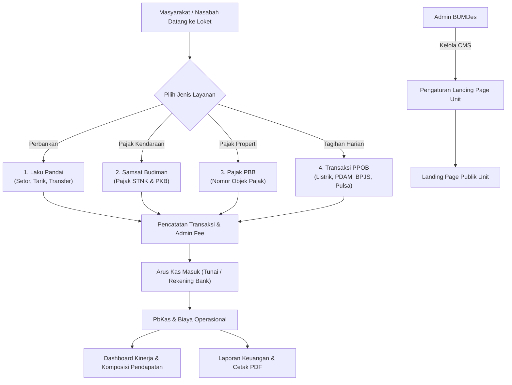
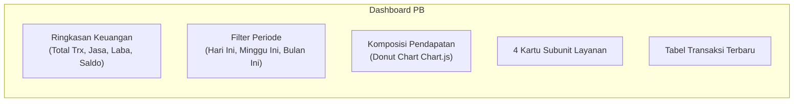
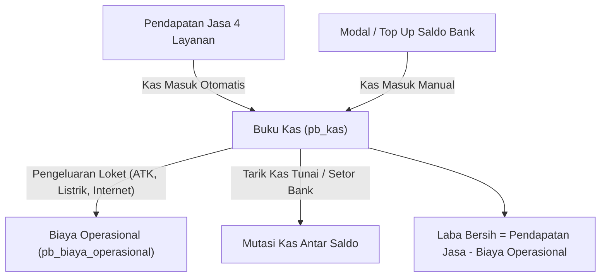

# DOKUMENTASI LENGKAP SISTEM & ALUR OPERASIONAL
## UNIT PERDAGANGAN BESAR — BUMDES DAMMAR WULAN DESA CIWUNI

Dokumen ini menyajikan panduan alur teknis, arsitektur data, dan proses bisnis dari **Unit Perdagangan Besar** secara lengkap dari awal hingga akhir.

---

## 1. PENDAHULUAN & TUJUAN UNIT

Unit Perdagangan Besar BUMDes Dammar Wulan Desa Ciwuni berfokus pada penyediaan **Layanan Transaksi Digital dan Keagenan Keuangan Desa**. Unit ini menjadi pusat loket pembayaran satu pintu (*one-stop payment and agency desk*) yang melayani masyarakat desa tanpa harus menempuh perjalanan jauh ke pusat kota atau kantor perbankan.

### 4 Pilar Layanan Utama
1. **Laku Pandai**: Layanan perbankan keagenan (Setor Tunai, Tarik Tunai, dan Transfer Antar Bank).
2. **Samsat Budiman**: Layanan pembayaran Pajak Kendaraan Bermotor (PKB) tahunan dan pengesahan STNK.
3. **Pajak PBB**: Penerimaan pembayaran Pajak Bumi dan Bangunan P2 berbasis NOP.
4. **Transaksi Umum / PPOB**: Pembayaran tagihan rutin (PLN Token/Pascabayar, PDAM, BPJS Kesehatan, Pulsa/Data, serta Top-Up E-Wallet).

---

## 2. ARSITEKTUR ALUR SISTEM (HIGH-LEVEL WORKFLOW)

---

## 3. AUTENTIKASI & HAK AKSES PENGGUNA

Halaman masuk unit dapat diakses melalui rute resmi:
`https://bumdesciwuni.com/unit/perdagangan-besar/login`

### Struktur Peran (Role-Based Access Control)
| Peran (Role) | Identitas Akun | Hak Akses Utama |
| :--- | :--- | :--- |
| **Administrator (`admin_unit` / `admin`)** | `admin@bumdes.com` | Akses penuh: Input transaksi seluruh subunit, kelola kas & biaya, manajemen nasabah & WP, ekspor laporan, dan Pengaturan Landing Page (CMS). |
| **Manager (`manager` / `manager_pusat`)** | `manager@bumdes.com` | Akses pengawasan: Monitoring dasbor keuangan, evaluasi grafik omzet & pendapatan jasa, dan audit laporan transaksi. |

### Alur Login:
1. Pengguna membuka URL `/unit/perdagangan-besar/login`.
2. Halaman menampilkan tema split-layout selaras dengan Unit Simpan Pinjam dengan logo resmi BUMDes.
3. Tombol pemilihan peran (**Administrator** atau **Manager**) secara otomatis mengisi email default akun penguji.
4. Sistem memverifikasi kredensial via `UnitLandingController::loginStore`.
5. Jika berhasil dan memiliki otorisasi, pengguna diarahkan ke dasbor utama `/unit/perdagangan-besar/dashboard`.

---

## 4. DASHBOARD OPERASIONAL & KEUANGAN

Dasbor utama (`PbDashboardController::index`) dirancang menggunakan bahasa desain Unit Simpan Pinjam (warna navy `#1e3a8a`, latar kontras, border lembut, dan kartu metrik interaktif).

### 1. Kartu Ringkasan Operasional & Keuangan
* **Total Transaksi**: Akumulasi jumlah transaksi dari 4 layanan pada periode terpilih.
* **Pendapatan Jasa**: Total komisi/biaya administrasi bersih yang diterima BUMDes.
* **Laba Bersih Unit**: `Pendapatan Jasa - Total Biaya Operasional`.
* **Saldo Terakhir**: Rincian posisi kas riil:
  - Saldo Tunai (Cash di laci loket).
  - Saldo Rekening (Bank/Giro/E-Wallet penampung operasional).
  - Total Saldo Keseluruhan.

### 2. Komposisi Pendapatan Layanan (Donut Chart)
* Menampilkan visualisasi persentase pendapatan jasa dari masing-masing subunit:
  - Laku Pandai (Biru `#2563eb`)
  - Samsat Budiman (Amber `#d97706`)
  - Pajak PBB (Hijau Emerald `#059669`)
  - Transaksi Umum/PPOB (Ungu Indigo `#4f46e5`)
* Dilengkapi kartu indikator metrik untuk setiap subunit lengkap dengan nominal dan persentase kontribusi terhadap total jasa.

### 3. Kinerja Per Layanan & Aktivitas Transaksi Terbaru
* 4 Card ringkasan cepat untuk tiap jenis layanan beserta tombol langsung menuju kelola transaksi.
* Tabel aktivitas transaksi gabungan *real-time* yang menyatukan log dari 4 tabel transaksi berbeda, diurutkan dari yang paling baru.

---

## 5. ALUR OPERASIONAL 4 SUBUNIT TRANSAKSI

### 5.1. Layanan Laku Pandai (Agen Bank)
* **Tujuan**: Memfasilitasi transaksi tabungan perbankan bagi warga.
* **Tipe Transaksi**:
  - `SETOR_TUNAI`: Warga menyetor uang tunai untuk dimasukkan ke rekening bank.
  - `TARIK_TUNAI`: Warga menarik dana tunai dari rekening mereka di loket BUMDes.
  - `TRANSFER`: Transfer dana antar bank atau sesama bank mitra.
* **Struktur Data**:
  - `pb_nasabah_laku_pandai`: NIK, nama nasabah, no rekening, bank mitra, nomor telepon, alamat.
  - `pb_transaksi_laku_pandai`: No transaksi, nasabah_id, jenis transaksi, nominal transaksi, biaya admin nasabah, pendapatan jasa BUMDes, status (`SELESAI`, `PENDING`, `BATAL`).
* **Pencatatan Otomatis**:
  - Biaya admin langsung dialokasikan ke Pendapatan Jasa BUMDes.
  - Transaksi otomatis mencatat mutasi pada `pb_kas`.

### 5.2. Layanan Samsat Budiman (Pajak Kendaraan)
* **Tujuan**: Membantu wajib pajak membayar Pajak Kendaraan Bermotor (PKB) tahunan tanpa antre di Samsat induk.
* **Database Wajib Pajak**:
  - `pb_wajib_pajak_samsat`: No polisi kendaraan, nama pemilik sesuai STNK, NIK, jenis kendaraan (Roda 2 / Roda 4), masa berlaku pajak & STNK.
* **Transaksi Pajak**:
  - `pb_transaksi_samsat`: No transaksi, no polisi, PKB pokok, SWDKLLJ, biaya admin Samsat, jasa agen BUMDes, total bayar, tanggal bayar, status cetak SKPD.

### 5.3. Layanan Pajak PBB (Pajak Bumi & Bangunan)
* **Tujuan**: Pelayanan pembayaran PBB-P2 bagi warga Desa Ciwuni.
* **Alur Transaksi**:
  1. Petugas menginput NOP (Nomor Objek Pajak) 18 digit.
  2. Mengisi nama wajib pajak, letak objek pajak (Dusun/RT/RW), tahun pajak.
  3. Memasukkan nominal PBB pokok dan denda (jika ada).
  4. Menetapkan biaya admin loket (misal: Rp 2.500 - Rp 3.000 per SPPT).
  5. Sistem menghitung total bayar dan mencatat komisi jasa BUMDes.

### 5.4. Layanan Transaksi Umum / PPOB
* **Tujuan**: Penjualan pulsa, paket data, token listrik, pembayaran tagihan air PDAM, dan BPJS.
* **Struktur Data (`pb_transaksi_umum`)**:
  - Kategori produk (`PLN`, `PDAM`, `BPJS`, `PULSA_DATA`, `E_WALLET`, `LAINNYA`).
  - No pelanggan / ID pelanggan / No HP.
  - Nama pelanggan.
  - Harga modal (beli dari server agen) & harga jual ke warga.
  - Laba / Jasa BUMDes (`Harga Jual - Harga Modal` atau biaya admin).

---

## 6. MANAJEMEN KEUANGAN: KAS & BIAYA OPERASIONAL

### Buku Kas (`pb_kas`)
* Mencatat setiap aliran dana masuk (`MASUK`) dan keluar (`KELUAR`).
* Membedakan jenis kas:
  - `TUNAI`: Fisik uang tunai di meja loket.
  - `REKENING`: Saldo rekening operasional bank.
* Memastikan pembukuan kas klop (*reconciled*) antara kas fisik dengan pencatatan digital di akhir hari operasional.

### Biaya Operasional (`pb_biaya_operasional`)
* Mencatat seluruh beban operasional loket:
  - Kertas struk & pita printer thermal.
  - Kuota internet modem loket.
  - Listrik loket dan perawatan perangkat komputer/EDC.
  - Biaya admin transfer antar rekening bank.

---

## 7. PELAPORAN & REKAPITULASI (EXPORT PDF)

* **Menu Laporan** (`/unit/perdagangan-besar/laporan`):
  - Pengguna dapat memilih filter rentang tanggal (dari tanggal A hingga tanggal B) atau filter per jenis layanan.
  - Menampilkan ringkasan omzet per layanan, total biaya admin terkumpul, total pengeluaran operasional, dan sisa laba bersih.
* **Cetak PDF Laporan Resmi** (`/unit/perdagangan-besar/laporan/cetak-pdf`):
  - Dibuat menggunakan Blade template berstandar cetak formal BUMDes (`resources/views/perdagangan_besar/laporan_pdf.blade.php`).
  - Memuat kop surat resmi BUMDes Dammar Wulan, nomor rekap, tabel rincian pendapatan & pengeluaran, serta lembar tanda tangan pengesahan (Direktur BUMDes & Kepala Unit).

---

## 8. CMS PENGATURAN LANDING PAGE UNIT

Halaman khusus di `/unit/perdagangan-besar/pengaturan-landing` memungkinkan admin unit memperbarui tampilan profil publik unit secara mandiri tanpa menyentuh kode program.

### Komponen Pengaturan:
1. **Section Hero (Banner Utama)**:
   - Judul Utama (*Hero Title*).
   - Subjudul / Penjelasan Singkat.
   - Teks Tombol Aksi (CTA) & Tautan Tujuan.
2. **Section Fitur & Layanan Utama**:
   - Judul dan deskripsi untuk 3 layanan unggulan loket perdagangan besar.
3. **Section Struktur Organisasi**:
   - Nama & upload foto Pembina, Penasihat, Direktur, Bendahara, Sekretaris, hingga Kepala Unit & Staf Loket.
   - Sistem otomatis mengompresi gambar ke format modern **WebP** guna performa loading kilat.
4. **Section Informasi & Kontak Loket**:
   - Alamat fisik loket, nomor telepon/WhatsApp bantuan, email, dan jam buka layanan.
5. **Section Berita, FAQ, dan Galeri Foto**:
   - Daftar tanya-jawab seputar layanan loket.
   - Berita terkini mengenai promosi atau perubahan jam buka.
   - Manajemen upload foto kegiatan pelayanan warga di loket.

---

## 9. DAFTAR FILE, MODEL, DAN RUTE LENGKAP

### Backend (Controllers, Models, Migrations)
| Komponen | Lokasi File | Fungsi |
| :--- | :--- | :--- |
| **Dashboard Controller** | `app/Http/Controllers/PerdaganganBesar/PbDashboardController.php` | Pengolahan statistik, filter periode, chart data, dan feed transaksi. |
| **Laku Pandai Controller** | `app/Http/Controllers/PerdaganganBesar/PbLakuPandaiController.php` | Transaksi setor/tarik/transfer & database nasabah. |
| **Samsat Controller** | `app/Http/Controllers/PerdaganganBesar/PbSamsatController.php` | Transaksi pajak PKB & database wajib pajak. |
| **PBB Controller** | `app/Http/Controllers/PerdaganganBesar/PbPbbController.php` | Pengelolaan pembayaran PBB berbasis NOP. |
| **Umum / PPOB Controller**| `app/Http/Controllers/PerdaganganBesar/PbTransaksiUmumController.php` | Transaksi pulsa, token listrik, PDAM, BPJS. |
| **Keuangan Controller** | `app/Http/Controllers/PerdaganganBesar/PbKeuanganController.php` | Buku kas masuk/keluar & biaya operasional. |
| **Laporan Controller** | `app/Http/Controllers/PerdaganganBesar/PbLaporanController.php` | Rekapitulasi laporan & cetak PDF. |
| **Unit Landing Controller**| `app/Http/Controllers/Portal/UnitLandingController.php` | Autentikasi login unit, landing page, & CMS settings. |
| **Models** | `app/Models/PerdaganganBesar/*.php` | Model Eloquent: `PbKas`, `PbBiayaOperasional`, `PbTransaksiLakuPandai`, dll. |
| **Migrations** | `database/migrations/perdagangan/*.php` | 5 file migrasi pembentuk tabel database. |

### Frontend (Inertia.js & Vue 3)
| Komponen | Lokasi File | Deskripsi |
| :--- | :--- | :--- |
| **Layout Utama** | `resources/js/Layouts/PerdaganganBesar/PerdaganganBesarLayout.vue` | Layout sidebar navy dengan kategori Transaksi, Keuangan, Laporan, Pengaturan, & Portal BUMDes. |
| **Halaman Login** | `resources/js/Pages/Perdagangan Besar/Login.vue` | Tampilan login split-screen selaras Unit Simpan Pinjam. |
| **Dashboard Page** | `resources/js/Pages/Perdagangan Besar/Dashboard.vue` | Dasbor metrik, donut chart, 4 card layanan, dan feed aktivitas. |
| **Chart Komponen** | `resources/js/Pages/Perdagangan Besar/Partials/PbRevenueCompositionChart.vue` | Komponen interaktif Donut Chart Chart.js. |
| **Halaman Layanan** | `resources/js/Pages/Perdagangan Besar/{LakuPandai, Samsat, Pbb, TransaksiUmum}/` | Formulir dan tabel transaksi per masing-masing layanan. |
| **Halaman Kas & Biaya** | `resources/js/Pages/Perdagangan Besar/Keuangan/{Kas, BiayaOperasional}.vue` | Antarmuka buku kas dan pengeluaran operasional. |
| **Halaman Laporan** | `resources/js/Pages/Perdagangan Besar/Laporan/Index.vue` | Filter laporan dan tombol cetak PDF. |
| **Halaman CMS Settings** | `resources/js/Pages/Perdagangan Besar/LandingPage/Settings.vue` | Formulir pengelolaan landing page unit selaras Simpan Pinjam. |

---

## 10. KESIMPULAN

Sistem **Unit Perdagangan Besar** kini beroperasi secara mandiri dan komprehensif, memiliki konsistensi visual 100% dengan **Unit Simpan Pinjam**, tanpa mengubah atau mengganggu kode unit-unit lain yang sudah berjalan di BUMDes Dammar Wulan. Seluruh modul mulai dari login, operasional loket 4 layanan, manajemen kas, pelaporan PDF, hingga CMS landing page telah terintegrasi penuh.
