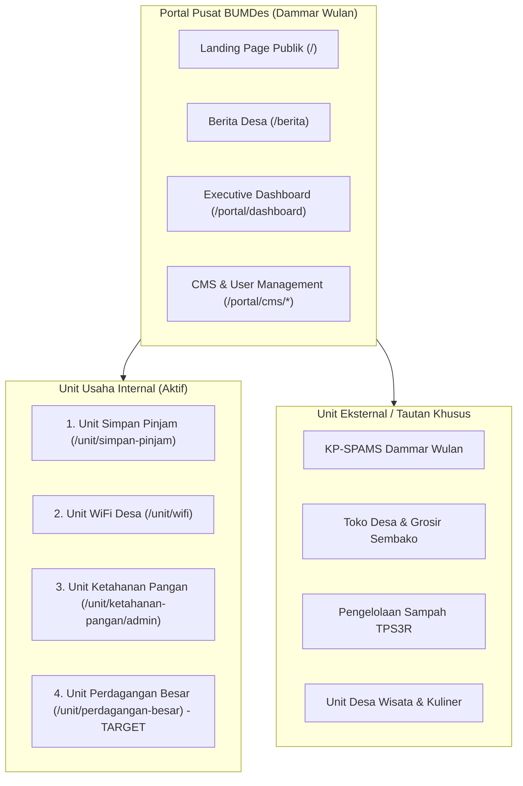
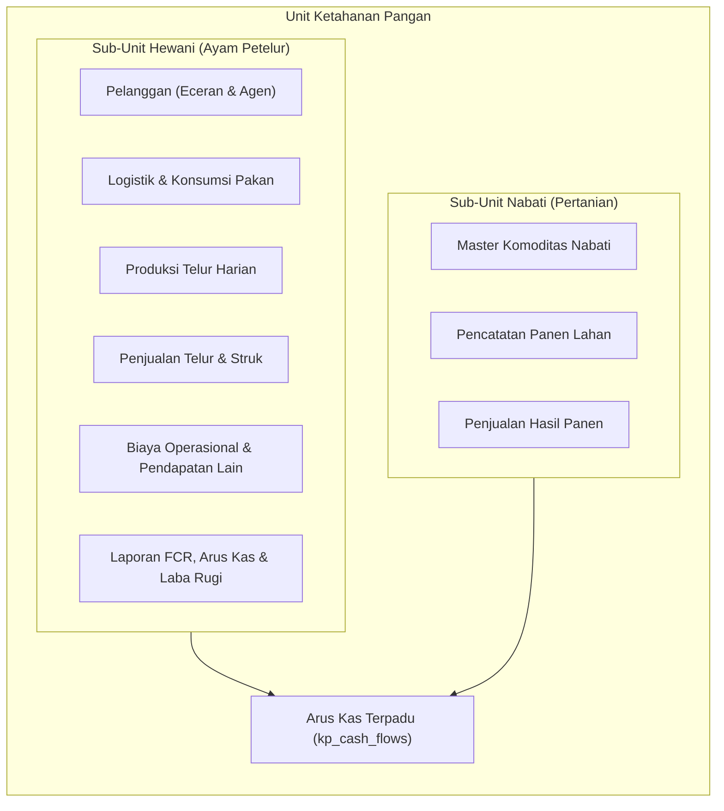
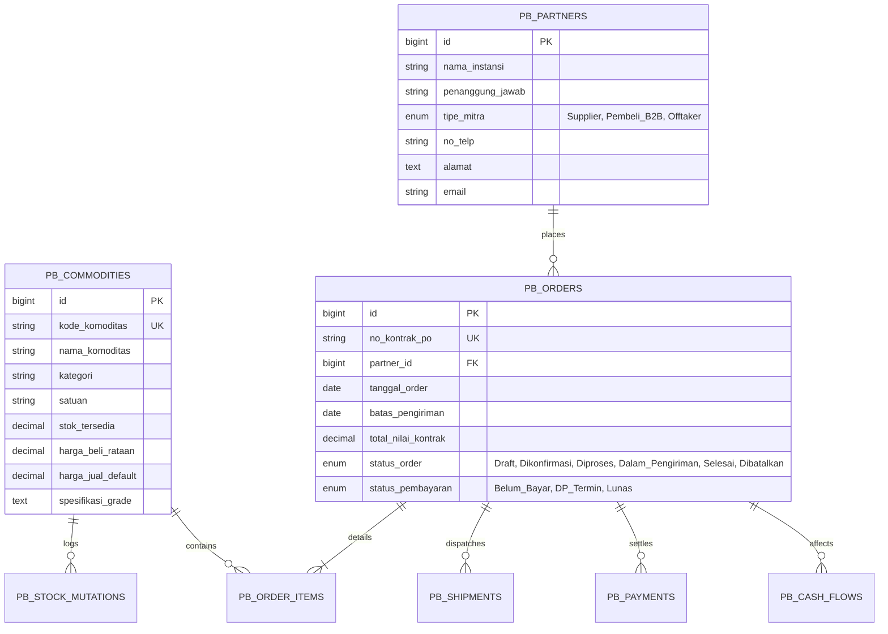

# Analisis dan Pemetaan Menyeluruh Sistem BUMDes Dammar Wulan (Ciwuni)

Dokumen ini disusun sebagai panduan menyeluruh mengenai arsitektur sistem, fitur yang telah selesai dibangun pada setiap unit usaha, konvensi teknis, serta cetak biru teknis untuk melanjutkan pembangunan **Unit Perdagangan Besar / Umum**.

---

## 1. Ikhtisar Arsitektur & Teknologi

Sistem BUMDes Ciwuni dibangun dengan pendekatan **Monolit Modern Terintegrasi (Multi-Unit BUMDes)**. Portal pusat mengelola landing page desa dan CMS, sementara masing-masing unit usaha internal memiliki landing page publik, alur login mandiri, dashboard, dan modul bisnisnya sendiri.

### Tech Stack Utama
- **Backend:** PHP 8.2+ / Laravel 13 (`laravel/framework: v13.12.0`)
- **Frontend:** Vue 3 (Composition API `<script setup>`) via Inertia.js v2
- **Styling:** Tailwind CSS v4, Material Symbols Outlined icons
- **Database:** SQLite untuk pengembangan lokal (`database/database.sqlite`), kompatibel penuh dengan MySQL/MariaDB di server produksi
- **Dokumen & Cetak:** `barryvdh/laravel-dompdf` (ekspor PDF struk & laporan), `maatwebsite/excel` (ekspor spreadsheet XLSX)
- **Peta & Geospasial:** `leaflet` (pemetaan sebaran pelanggan WiFi)
- **Visualisasi Data:** `chart.js` (dashboard analitik)

---

## 2. Struktur Hak Akses (Role-Based Access Control)

Sistem memiliki pembagian peran yang ketat di [User.php](file:///d:/PROJECT%20LATAGON/BumdesCiwuni/app/Models/User.php) dan diverifikasi melalui middleware [RoleMiddleware.php](file:///d:/PROJECT%20LATAGON/BumdesCiwuni/app/Http/Middleware/RoleMiddleware.php) serta [PinMiddleware.php](file:///d:/PROJECT%20LATAGON/BumdesCiwuni/app/Http/Middleware/PinMiddleware.php):

| Role | Identitas | Hak Akses Utama | Akun Bawaan (Email / Password) |
| :--- | :--- | :--- | :--- |
| `admin` | Super Admin | Akses tanpa batas ke CMS, manajemen unit, kelola user (dengan proteksi PIN), serta dashboard semua unit. | `admin@bumdes.com` / `password` |
| `manager_pusat` | Manager Eksekutif BUMDes | Akses monitoring dan laporan di **Executive Dashboard** (`/portal/dashboard`) untuk seluruh unit usaha (read-only analitik). | `manager@bumdes.com` / `password` |
| `admin_unit` | Admin Unit WiFi | Akses operasional unit WiFi (`/unit/wifi`). | `wifi@bumdes.com` / `password` |
| `admin_unit` | Admin Ketahanan Pangan | Akses operasional unit Ketahanan Pangan (`/unit/ketahanan-pangan/admin`). | `pangan@bumdes.com` / `password` |
| `admin_unit` | Admin Perdagangan Besar | Akses operasional unit Perdagangan Besar (`/unit/perdagangan-besar`). | `perdagangan@bumdes.com` / `password` |

---

## 3. Analisis Modul & Unit Usaha yang Sudah Selesai

### A. Portal BUMDes, CMS & Executive Dashboard
- **Landing Page Publik:** Profil BUMDes, banner dinamis, daftar unit usaha dengan status dan ikon, berita desa, dan kontak.
- **CMS Admin:**
  - Kustomisasi profil BUMDes, banner hero, visi-misi ([CmsController.php](file:///d:/PROJECT%20LATAGON/BumdesCiwuni/app/Http/Controllers/Portal/CmsController.php)).
  - Manajemen Berita & Galeri Desa ([PostController.php](file:///d:/PROJECT%20LATAGON/BumdesCiwuni/app/Http/Controllers/Portal/PostController.php)).
  - Master Unit Usaha ([UnitController.php](file:///d:/PROJECT%20LATAGON/BumdesCiwuni/app/Http/Controllers/Portal/UnitController.php)): Tambah/edit unit, tipe internal/eksternal, url, ikon, urutan.
  - Kelola Pengguna terproteksi PIN keamanan 6-digit ([AdminUserController.php](file:///d:/PROJECT%20LATAGON/BumdesCiwuni/app/Http/Controllers/AdminUserController.php)).
- **Executive Dashboard:** Ringkasan agregat kinerja finansial, saldo kas, dan transaksi dari semua unit usaha untuk pimpinan.

---

### B. Unit 1: Unit Simpan Pinjam (`/unit/simpan-pinjam`)
Unit tertua dan paling lengkap fiturnya:
- **Master Nasabah:** Pencatatan identitas, NIK, alamat, kategori (Warga, Umum), foto profil, dan dokumen jaminan.
- **Tabungan Reguler:** Setor, tarik tunai, cetak bukti transaksi struk thermal 80mm & PDF, riwayat mutasi per rekening.
- **Tabungan Sembako:** Tabungan khusus paket hari raya (setor, ambil paket sembako, cetak struk).
- **Pinjaman Mikro:** Kalkulasi bunga otomatis, tenor (mingguan/pasaran/bulanan), approval, cetak perjanjian.
- **Angsuran:** Pembayaran cicilan pinjaman, kalkulasi denda keterlambatan, cetak kwitansi pembayaran.
- **Buku Tabungan & Tunggakan:** Rekapitulasi per nasabah, monitoring jatuh tempo dan daftar tunggakan nasabah.
- **Pendapatan & Laporan Lengkap:** Laporan kas, laba operasional bunga, selisih kas, ekspor format PDF & Excel (`maatwebsite/excel`).
- **Tutup Buku Massal:** Mekanisme penutupan buku tahunan / pembagian SHU secara massal.

---

### C. Unit 2: Unit WiFi Desa (`/unit/wifi`)
Unit penyedia layanan internet warga:
- **Manajemen Pelanggan:** Registrasi pelanggan WiFi, nomor pelanggan otomatis, paket internet, nomor WhatsApp, lokasi RT/RW, gelombang pembayaran (1-15 atau 16-30).
- **Status Otomatis (AKTIF / ISOLIR):** Logika otomatis berbasis tanggal cutoff gelombang dan status lunas pembayaran bulan berjalan.
- **Peta Sebaran Pelanggan (GIS):** Visualisasi sebaran letak pelanggan dan tiang menggunakan Leaflet.js dengan penanda warna status (Hijau = Aktif, Merah = Isolir).
- **Pembayaran & Tagihan:** Input pembayaran bulanan, fitur **Bayar Massal** (multi-pilih pelanggan), cetak struk pembayaran, kirim notifikasi via WhatsApp.
- **Skema Bagi Hasil Provider:** Formula fleksibel dasar tarikan non-PPN, perhitungan persentase hak BUMDes (default 9%), hak provider, dan alokasi PPN/cadangan jaringan.
- **Laporan & Ekspor:** Laporan per provider, rekonsiliasi kas (Tunai vs Transfer), ekspor PDF dan Excel.

---

### D. Unit 3: Unit Ketahanan Pangan (`/unit/ketahanan-pangan/admin`) *(Baru Saja Selesai)*
Unit terbaru yang terbagi menjadi 2 sub-sektor strategis:

1. **Sub-Unit Hewani (Peternakan Layer / Ayam Petelur):**
   - **Pelanggan:** Klasifikasi pembeli Eceran dan Agen/Grosir.
   - **Logistik Pakan:** Pencatatan pembelian pakan (harga, supplier, stok kg), serta pemakaian harian berdasarkan populasi ayam dan standar gram per ekor.
   - **Produksi Harian:** Pencatatan telur utuh (kg), telur retak/rusak (butir), dan estimasi nilai pendapatan.
   - **Penjualan Telur:** Generator nomor transaksi otomatis, cetak struk transaksi, metode bayar (Tunai, Transfer, QRIS, Hutang).
   - **Keuangan & Laporan:** Pencatatan biaya tetap & variabel (listrik, vaksin, gaji, sewa), pendapatan sampingan (kotoran ayam/pupuk kandang), laporan arus kas, serta laporan laba-rugi.
2. **Sub-Unit Nabati (Pertanian Tanaman Pangan):**
   - **Master Komoditas:** Padi, jagung, sayuran, dll (satuan kg/ikat, stok, harga acuan).
   - **Pencatatan Panen:** Tanggal panen, volume panen, identifikasi petak lahan.
   - **Penjualan Panen:** Transaksi penjualan hasil bumi desa, status bayar, dan pencatatan kas masuk.

---

## 4. Analisis Unit yang Belum Dikerjakan: Unit Perdagangan Besar

Unit ini adalah target tugas Anda berikutnya (`slug: perdagangan-besar`, ID Unit: 8 di tabel `units`).

### Kondisi Saat Ini di Codebase:
1. **Database:** Belum ada tabel database khusus untuk Perdagangan Besar (`pb_*`).
2. **Backend:** Belum ada Controller, Model Eloquent, atau route transaksi khusus. Hanya ada rute dasar di [UnitLandingController.php](file:///d:/PROJECT%20LATAGON/BumdesCiwuni/app/Http/Controllers/Portal/UnitLandingController.php) yang mengembalikan array kosong `$stats = []`.
3. **Frontend:**
   - [resources/js/Pages/Perdagangan Besar/Welcome.vue](file:///d:/PROJECT%20LATAGON/BumdesCiwuni/resources/js/Pages/Perdagangan%20Besar/Welcome.vue): Landing page publik.
   - [resources/js/Pages/Perdagangan Besar/Login.vue](file:///d:/PROJECT%20LATAGON/BumdesCiwuni/resources/js/Pages/Perdagangan%20Besar/Login.vue): Halaman login khusus unit.
   - [resources/js/Pages/Perdagangan Besar/Dashboard.vue](file:///d:/PROJECT%20LATAGON/BumdesCiwuni/resources/js/Pages/Perdagangan%20Besar/Dashboard.vue): Dashboard saat ini **masih berupa dummy/mockup data statis** di dalam variabel Vue `ref([])` (berisi contoh pesanan dummy: PT Indofood Makmur, CV Nusantara Spices, komoditas Kopi Robusta, Cengkeh, Minyak Kelapa VCO, Kopra Putih).

---

## 5. Cetak Biru Teknis: Melanjutkan Unit Perdagangan Besar

Berdasarkan pola yang sukses diterapkan pada **Unit WiFi** dan **Unit Ketahanan Pangan**, berikut adalah rancangan arsitektur standar yang sebaiknya Anda terapkan saat mengembangkan Unit Perdagangan Besar:

### A. Rencana Skema Database (`pb_*` / Perdagangan Besar)

### B. Daftar Fitur yang Perlu Dibangun:
1. **Master Komoditas & Gudang (Inventory Skala Besar):**
   - Komoditas unggulan (Kopi Robusta Grade A, Cengkeh Kering, Minyak Kelapa VCO, Kopra, atau hasil bumi lokal lainnya).
   - Multi-satuan (Kilogram, Ton, Karung, Liter).
   - Riwayat stok masuk (pembelian dari petani lokal) dan stok keluar (penjualan B2B).
2. **Mitra & Offtaker (B2B CRM):**
   - Data pabrikan, eksportir, grosir besar, koperasi mitra, dan kelompok tani penyuplai.
3. **Pemesanan & Kontrak Jual-Beli (Purchase Orders / PO):**
   - Nomor PO / Invoice otomatis, pencatatan tonase/volume, harga satuan, diskon, dan termin pembayaran (DP, Termin/Kredit, COD).
4. **Logistik & Pengiriman (Surat Jalan / Delivery Order):**
   - Nomor surat jalan pengiriman, ekspedisi/armada angkut, status pengiriman.
5. **Cetak Dokumen Resmi:**
   - Surat Perjanjian / Kontrak Jual-Beli (PO).
   - Invoice / Faktur Tagihan Grosir (PDF DomPDF).
   - Surat Jalan Pengiriman Barang.
6. **Laporan & Finansial:**
   - Rekap omzet penjualan grosir, margin keuntungan, piutang mitra B2B, dan arus kas.

### C. Pola Struktur File yang Disarankan:
- **Routes:** Dikelompokkan di [routes/web.php](file:///d:/PROJECT%20LATAGON/BumdesCiwuni/routes/web.php) di bawah prefix `unit/perdagangan-besar/*`.
- **Controllers:** `app/Http/Controllers/PerdaganganBesar/*`
  - `PbDashboardController.php`
  - `PbKomoditasController.php`
  - `PbMitraController.php`
  - `PbTransaksiController.php`
  - `PbLaporanController.php`
- **Models:** `app/Models/PerdaganganBesar/*`
- **Views (Vue Inertia):** `resources/js/Pages/Perdagangan Besar/*`
  - `Dashboard.vue` (dihubungkan dengan data riil database)
  - `Komoditas/Index.vue`
  - `Mitra/Index.vue`
  - `Pesanan/Index.vue`, `Pesanan/Create.vue`, `Pesanan/Show.vue`
  - `Laporan/Index.vue`
- **Layout:** Menggunakan layout sidebar konsisten seperti [KetahananPanganLayout.vue](file:///d:/PROJECT%20LATAGON/BumdesCiwuni/resources/js/Layouts/KetahananPangan/KetahananPanganLayout.vue) atau membuat `PerdaganganBesarLayout.vue`.

---

## 6. Inventaris Lengkap Database (36 Tabel Terpasang)

Berikut adalah daftar lengkap 36 tabel yang saat ini ada di [database.sqlite](file:///d:/PROJECT%20LATAGON/BumdesCiwuni/database/database.sqlite):

| Kategori | Nama Tabel | Deskripsi & Fungsi |
| :--- | :--- | :--- |
| **Sistem / Auth** | `users` | Data akun pengguna, autentikasi, kolom `role` dan `unit_id`. |
| | `password_reset_tokens` | Token reset kata sandi email. |
| | `sessions` | Sesi aktif web (driver database). |
| | `cache`, `cache_locks` | Penyimpanan cache framework Laravel. |
| | `jobs`, `job_batches`, `failed_jobs` | Antrean background worker (queue database). |
| | `migrations` | Riwayat migrasi database terpasang. |
| **Portal Pusat** | `units` | Master data 8 unit usaha (nama, slug, tipe internal/eksternal, icon, status). |
| | `posts` | Berita desa publik dan artikel CMS. |
| | `website_settings` | Konfigurasi profil umum BUMDes (nama, visi, misi, kontak). |
| | `landing_page_settings` | Kustomisasi dinamis per-unit (hero banner, about, FAQ, pengurus). |
| | `galeri_unit` | Galeri foto kegiatan per-unit usaha. |
| **Simpan Pinjam** | `nasabah` | Master nasabah simpan pinjam (data diri, foto profil, jaminan). |
| | `tabungan` | Rekening tabungan reguler & sembako nasabah beserta saldonya. |
| | `transaksi_tabungan` | Mutasi setor dan tarik tabungan (termasuk nomor transaksi). |
| | `pinjaman` | Master pinjaman mikro, pokok, bunga, tenor, total tagihan, foto barang. |
| | `angsuran` | Catatan pembayaran cicilan pinjaman & denda. |
| | `kwitansi` | Arsip nomor kwitansi pembayaran resmi. |
| **Unit WiFi** | `pelanggan_wifi` | Data pelanggan internet (paket, kontak, RT/RW, gelombang, status). |
| | `pembayaran_wifi` | Transaksi iuran bulanan pelanggan WiFi, tanggal bayar, metode kas/transfer. |
| | `provider_wifi` | Master ISP/mitra provider, persentase bagi hasil, nomor rekening, template WA. |
| **Ketahanan Pangan** | `kp_customers` | Pelanggan telur/hasil tani (kategori Eceran & Agen). |
| | `kp_products` | Master jenis produk telur & harga acuan. |
| | `kp_feed_stocks` | Master inventaris pakan ayam layer. |
| | `kp_feed_purchases` | Pembelian stok pakan dari supplier (stok masuk & biaya). |
| | `kp_feed_usages` | Pemakaian harian pakan ayam (berdasarkan populasi & gram/ekor). |
| | `kp_egg_productions` | Produksi harian telur (bagus/kg, retak/butir, rusak/butir). |
| | `kp_egg_sales` | Transaksi penjualan telur grosir/eceran beserta cetak struk. |
| | `kp_expenses` | Beban biaya operasional hewani/nabati (tetap & variabel). |
| | `kp_other_incomes` | Pendapatan sampingan (penjualan pupuk kandang/kotoran, karung). |
| | `kp_cash_flows` | Arus kas mutasi debit/kredit terpadu unit pangan. |
| | `kp_plant_commodities`| Master komoditas hasil tani nabati. |
| | `kp_plant_productions`| Pencatatan hasil panen lahan nabati. |
| | `kp_plant_sales` | Transaksi penjualan hasil panen nabati. |

---

## 7. Inventaris Lengkap Controller & Modul Backend

1. **Portal & CMS (`App\Http\Controllers\Portal`):**
   - [PortalController.php](file:///d:/PROJECT%20LATAGON/BumdesCiwuni/app/Http/Controllers/Portal/PortalController.php): Beranda publik dan berita desa.
   - [CmsController.php](file:///d:/PROJECT%20LATAGON/BumdesCiwuni/app/Http/Controllers/Portal/CmsController.php): Dashboard CMS, profil BUMDes, banner, upload gambar.
   - [PostController.php](file:///d:/PROJECT%20LATAGON/BumdesCiwuni/app/Http/Controllers/Portal/PostController.php): CRUD postingan berita.
   - [UnitController.php](file:///d:/PROJECT%20LATAGON/BumdesCiwuni/app/Http/Controllers/Portal/UnitController.php): CRUD daftar unit usaha.
   - [UnitLandingController.php](file:///d:/PROJECT%20LATAGON/BumdesCiwuni/app/Http/Controllers/Portal/UnitLandingController.php): Gateway publik `welcome`, `login`, `dashboard`, dan `settings` per unit.
   - [ExecDashboardController.php](file:///d:/PROJECT%20LATAGON/BumdesCiwuni/app/Http/Controllers/Portal/ExecDashboardController.php): Executive dashboard untuk level manajemen.

2. **Simpan Pinjam (`App\Http\Controllers\SimpanPinjam`):**
   - [DashboardController.php](file:///d:/PROJECT%20LATAGON/BumdesCiwuni/app/Http/Controllers/SimpanPinjam/DashboardController.php): Ringkasan metrik simpan pinjam.
   - [NasabahController.php](file:///d:/PROJECT%20LATAGON/BumdesCiwuni/app/Http/Controllers/SimpanPinjam/NasabahController.php): Manajemen nasabah & dokumen.
   - [TabunganController.php](file:///d:/PROJECT%20LATAGON/BumdesCiwuni/app/Http/Controllers/SimpanPinjam/TabunganController.php): Tabungan reguler & struk 80mm PDF.
   - [TabunganSembakoController.php](file:///d:/PROJECT%20LATAGON/BumdesCiwuni/app/Http/Controllers/SimpanPinjam/TabunganSembakoController.php): Tabungan hari raya sembako.
   - [PinjamanController.php](file:///d:/PROJECT%20LATAGON/BumdesCiwuni/app/Http/Controllers/SimpanPinjam/PinjamanController.php): Pengajuan, simulasi hitung bunga/tenor, approval pinjaman.
   - [AngsuranController.php](file:///d:/PROJECT%20LATAGON/BumdesCiwuni/app/Http/Controllers/SimpanPinjam/AngsuranController.php): Pembayaran cicilan & cetak bukti bayar.
   - [BukuTabunganController.php](file:///d:/PROJECT%20LATAGON/BumdesCiwuni/app/Http/Controllers/SimpanPinjam/BukuTabunganController.php): Mutasi buku rekening.
   - [TunggakanPinjamanController.php](file:///d:/PROJECT%20LATAGON/BumdesCiwuni/app/Http/Controllers/SimpanPinjam/TunggakanPinjamanController.php): Monitoring kredit macet/terlambat.
   - [KwitansiController.php](file:///d:/PROJECT%20LATAGON/BumdesCiwuni/app/Http/Controllers/SimpanPinjam/KwitansiController.php): Pencetakan kwitansi resmi.
   - [PendapatanController.php](file:///d:/PROJECT%20LATAGON/BumdesCiwuni/app/Http/Controllers/SimpanPinjam/PendapatanController.php): Rekap pendapatan bunga & administrasi.
   - [LaporanController.php](file:///d:/PROJECT%20LATAGON/BumdesCiwuni/app/Http/Controllers/SimpanPinjam/LaporanController.php): Laporan keuangan (Nasabah, Kas, Angsuran, Pinjaman, Selisih Kas).
   - [PengaturanTabunganController.php](file:///d:/PROJECT%20LATAGON/BumdesCiwuni/app/Http/Controllers/SimpanPinjam/PengaturanTabunganController.php): Konfigurasi bunga & fitur tutup buku tahunan.

3. **Unit WiFi (`App\Http\Controllers\Wifi`):**
   - [WifiPelangganController.php](file:///d:/PROJECT%20LATAGON/BumdesCiwuni/app/Http/Controllers/Wifi/WifiPelangganController.php): CRUD pelanggan, ekspor/impor Excel, peta Leaflet.
   - [WifiPembayaranController.php](file:///d:/PROJECT%20LATAGON/BumdesCiwuni/app/Http/Controllers/Wifi/WifiPembayaranController.php): Input tagihan, bayar massal, struk & template WA.
   - [WifiProviderController.php](file:///d:/PROJECT%20LATAGON/BumdesCiwuni/app/Http/Controllers/Wifi/WifiProviderController.php): Skema bagi hasil komisi BUMDes & provider.
   - [WifiLaporanController.php](file:///d:/PROJECT%20LATAGON/BumdesCiwuni/app/Http/Controllers/Wifi/WifiLaporanController.php): Laporan rekapitulasi performa provider.
   - [WifiPendapatanController.php](file:///d:/PROJECT%20LATAGON/BumdesCiwuni/app/Http/Controllers/Wifi/WifiPendapatanController.php): Pendapatan kotor & kas masuk WiFi.

4. **Unit Ketahanan Pangan (`App\Http\Controllers\KetahananPangan`):**
   - [KpHewaniDashboardController.php](file:///d:/PROJECT%20LATAGON/BumdesCiwuni/app/Http/Controllers/KetahananPangan/KpHewaniDashboardController.php): Metrik peternakan ayam petelur & pakan.
   - [KpCustomerController.php](file:///d:/PROJECT%20LATAGON/BumdesCiwuni/app/Http/Controllers/KetahananPangan/KpCustomerController.php): Manajemen pelanggan telur (agen vs eceran).
   - [KpFeedController.php](file:///d:/PROJECT%20LATAGON/BumdesCiwuni/app/Http/Controllers/KetahananPangan/KpFeedController.php): Logistik pembelian dan konsumsi pakan harian.
   - [KpProductionController.php](file:///d:/PROJECT%20LATAGON/BumdesCiwuni/app/Http/Controllers/KetahananPangan/KpProductionController.php): Produksi telur harian (bagus, retak, rusak).
   - [KpSaleController.php](file:///d:/PROJECT%20LATAGON/BumdesCiwuni/app/Http/Controllers/KetahananPangan/KpSaleController.php): Transaksi kasir penjualan telur & cetak struk.
   - [KpFinanceController.php](file:///d:/PROJECT%20LATAGON/BumdesCiwuni/app/Http/Controllers/KetahananPangan/KpFinanceController.php): Pengeluaran operasional & pendapatan lain.
   - [KpReportController.php](file:///d:/PROJECT%20LATAGON/BumdesCiwuni/app/Http/Controllers/KetahananPangan/KpReportController.php): Laporan FCR, produksi, penjualan, arus kas, laba rugi.
   - [KpNabatiController.php](file:///d:/PROJECT%20LATAGON/BumdesCiwuni/app/Http/Controllers/KetahananPangan/KpNabatiController.php): Komoditas hasil tani, panen lahan, dan penjualan nabati.

---

## 8. Checklist Cepat Sebelum Mulai Coding
- [x] Pastikan database lokal migrasinya selalu ter-update (`php artisan migrate`).
- [x] Gunakan skrip dev yang sudah disesuaikan (`composer run dev`).
- [ ] Buat file migration tabel `pb_*` baru.
- [ ] Buat seeder data awal komoditas & mitra untuk uji coba.
- [ ] Daftarkan route baru di `routes/web.php`.
- [ ] Bangun komponen Vue dengan styling Tailwind dan Material Symbols.
